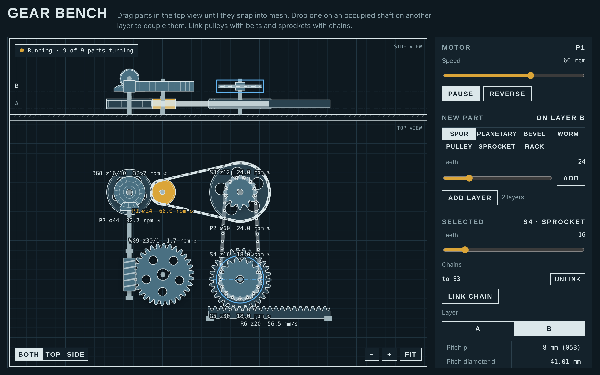

# mechanical-game

**Gear Bench** is a sandbox for building machines out of separate mechanical parts. Put gears, shafts, pulleys and mechanisms on a drafting sheet, drag them into mesh, add one or several motors, and read speed, torque and power anywhere in the train. It runs as a desktop app on Windows and Linux, or as a single HTML file in any browser. The interface is in English and Russian.



## Download

Get the latest build from [Releases](https://github.com/m-iller/mechanical-game/releases):

| File | For |
| --- | --- |
| `gear-bench-…-windows-setup.exe` | Windows installer |
| `gear-bench-…-windows-portable.exe` | Windows, no install |
| `gear-bench-…-linux-x86_64.AppImage` | Any Linux distro: `chmod +x`, then run |
| `gear-bench-…-linux-amd64.deb` | Debian, Ubuntu, Kubuntu |
| `gear-bench.html` | Any browser, one self-contained file |

The Windows builds are not code-signed, so SmartScreen shows a warning on first launch. Choose "More info", then "Run anyway".

## Parts

Every part is a separate piece. Nothing is a ready-made "drive"; a drive is what you get when parts touch.

| Group | Parts |
| --- | --- |
| Gears | spur gear, ring gear with internal teeth, bevel gear, bevel pinion on a horizontal axis, worm, rack |
| Belts, chains, friction | pulley, sprocket, friction wheel |
| Shafts and couplings | vertical shaft through any span of layers, horizontal shaft, planet carrier, friction clutch, brake, differential, flywheel |
| Mechanisms | crank and piston, cam and follower, Geneva drive, ratchet |

How they connect:

- **Mesh**: drag a gear until its pitch circle touches another. A gear inside a ring gear meshes on the inside. A gear beside a worm becomes its wheel. A bevel pinion snaps onto a bevel gear's rim.
- **Shafts**: drop a part on the centre of a part on another layer and a shaft joins them. Select a shaft to stretch it across more layers. Parts can also run free on a shaft.
- **Carrier**: drop gears on its pins and they orbit with it. A sun in the middle, planets on the pins and a ring around them make a planetary stage; hold any member, or drive two of them.
- **Belts and chains**: select any number of pulleys or sprockets on one layer and join them. The loop follows the outer hull of the wheels.
- **Clutch and differential**: each joins the shaft arriving from below to the shaft leaving above.
- **Templates** insert whole assemblies built from the same parts: planetary stage, two-stage reducer, worm pair, bevel pair, belt and chain drives, rack and pinion, differential with a brake, clutch.

All teeth use module 2 mm and a 20° pressure angle. Chain is 8 mm pitch (ISO 05B).

## Sources, consumers and rough figures

The branch `engineering-tool` turns the sandbox into a tool for quick estimates, to an accuracy of 10–20 %. See [docs/ROADMAP.md](docs/ROADMAP.md) for the plan and [CHANGELOG.md](CHANGELOG.md) for what is in.

- **Electric motor**: a part with a mechanical characteristic. Induction (rated power, rated speed, starting and breakdown torque), DC, stepper, or an ideal "set speed" or "set torque" source.
- **Machine (black box)**: a named consumer with a load law (constant, linear, fan law, table) and an efficiency.
- The train runs at the speed where the motor's torque equals the load torques reduced to its shaft. Torque and power at each part follow the power passing through it.
- Click an underlined figure to see **where it comes from**: the formula, the numbers and the assumptions.
- **Warnings** tell when a model is outside its range: stall, overload, undercut and others.

## What it shows

- Speed and direction of every part, for any number of motors.
- For the selected part: pitch, tip, root and base diameters, pitch, face width, cone angles, worm lead angle, and the centre distance and ratio of each of its meshes.
- Input and output speed, torque and power, total ratio and efficiency. Any part can be the output.
- A "Dimensions" overlay with pitch diameters and centre distances on the drawing.
- Why a train will not turn: overlapping parts, a loop that fights itself, teeth that cannot line up (the assembly condition of a planetary stage), a worm of up to four starts driven by its wheel, a ratchet turned the wrong way.

## Controls

- **Drag** a part in the top view; it snaps into mesh, onto a shaft axis or onto a carrier pin.
- **Hold** on empty space, then drag, to select an area. Shift-click adds to the selection. Selected parts move, rotate, change layer, duplicate and delete together.
- **Layers**: add, delete, reorder, hide, lock, name. Only the active layer takes the pointer; the others are faded and let clicks through.
- **Side view**: drag a part along x and up or down between layers, pull a shaft by its ends, click a layer's letter to make it active.
- Space pauses. R rotates the selection. Delete removes it. Ctrl+D duplicates. Scroll or pinch to zoom.

Your bench is saved automatically between sessions.

## Run from source

```sh
npm install
npm start          # desktop app
npm run bundle     # dist/gear-bench.html, one self-contained file
npm run dist       # installers for the current OS, in release/
npm test           # calculation-core tests
```

The app is plain HTML, CSS and JavaScript with no runtime dependencies. `main.js` is a small Electron shell around it.

| File | What is in it |
| --- | --- |
| `src/js/strings.js` | interface text, English and Russian |
| `src/js/core/` | DOM-free core: units, explanations, warnings, ports, scene migrations, load characteristics |
| `src/js/model.js` | part catalogue, scene state, layers, save and load |
| `src/js/paths.js` | part outlines, belt and chain routing |
| `src/js/solver.js` | kinematics: speeds, tooth phases, locks |
| `src/js/power.js` | operating point of each train, power flow, applicability checks |
| `src/js/draw.js` | top and side views |
| `src/js/templates.js` | ready-made assemblies and the opening example |
| `src/js/ui.js` | panel, pointer and keyboard input |

## How the solver works

Each rigid group of parts is one unknown speed. Each contact is one linear equation between two or three speeds, for example `zA·ωA + zB·ωB − (zA + zB)·ωc = 0` for an external mesh riding on carrier `c`. Motors and holds pin speeds to numbers. The equations are eliminated one at a time, so the first one that contradicts the others names the parts that jam, and speeds that nothing determines are reported as free. Tooth phases are a second system of the same shape, solved modulo one pitch.

## Releasing

Bump `version` in `package.json` and push to `main`. The `Release` workflow builds on Windows and Linux runners, creates the tag `v<version>` and attaches every file to a GitHub release. Pushes that leave the version unchanged do nothing.

## What the model leaves out

This is a kinematic model: rigid parts, exact ratios, no dynamics.

- No belt slip, chain polygon effect, backlash or inertia: the operating point is a steady state. Torque figures use typical stage efficiencies. With no loads on the bench, all power is assumed to leave at the chosen output.
- A differential with nothing deciding the split turns both shafts equally.
- Tooth profiles are true involutes, without undercut or root fillets. Bevel and worm teeth are drawn schematically.
- The rack is endless: its teeth scroll while the bar stays between its guides.
- Crank and piston, cam and follower, the Geneva drive and the differential are single units, not assembled from loose parts.
- Two coaxial shafts cannot pass through the same layer, so there are no hollow shafts.

## Licence

MIT. See [LICENSE](LICENSE).
